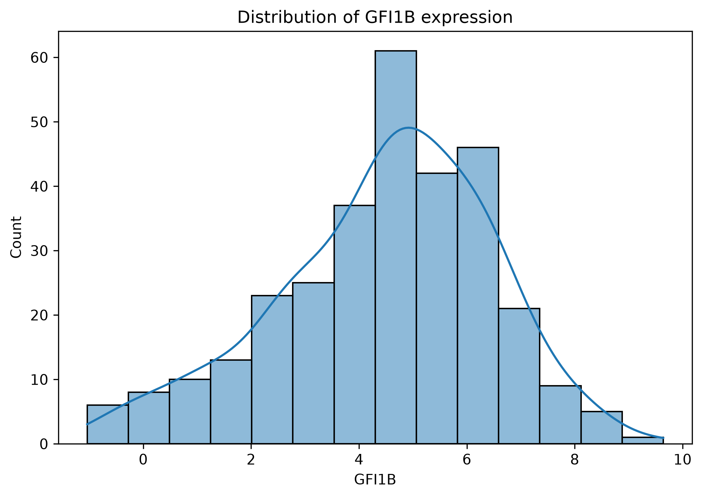
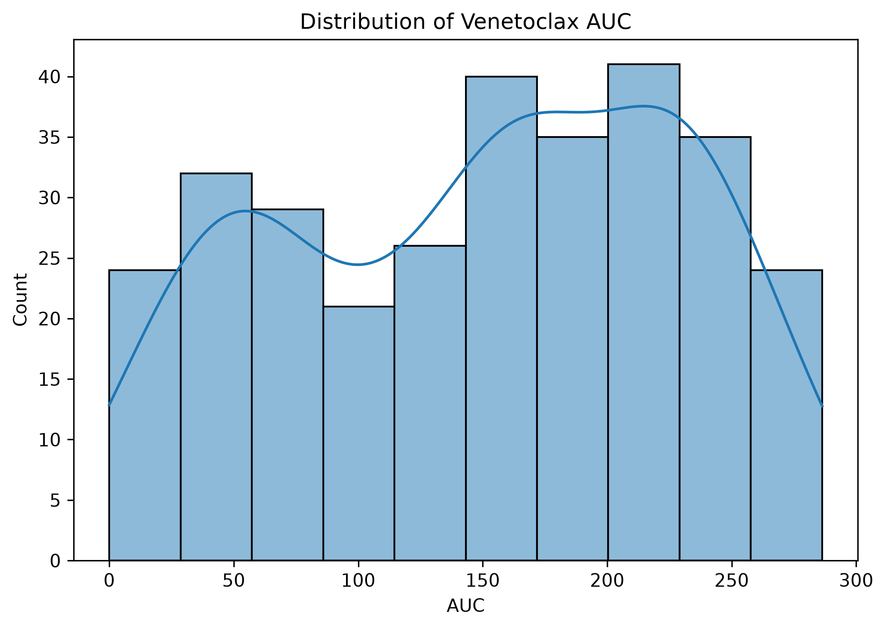
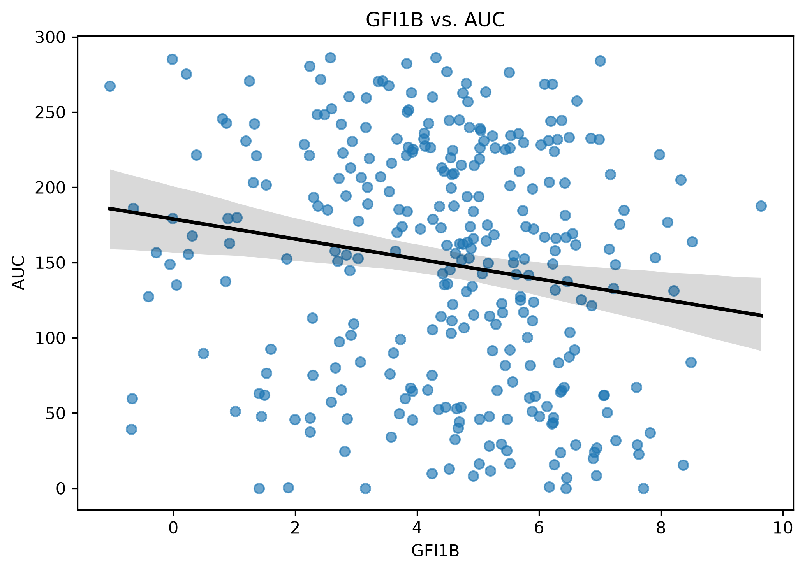

## GFI1B-Expression und ex-vivo-Venetoclax-Sensitivität in AML-Proben
In dieser Analyse wende ich statistische Methoden auf eine Fragestellung anhand eines öffentlich verfügbaren 
Datensatzes an, um meine Erfahrungen mit Datenanalysen zu veranschaulichen. 
Das Ziel soll dabei die praktische Anwendung statistischer Methoden sein und nicht, wissenschaftliche Erkenntnisse abzuleiten.

Ausgangspunkt ist die Studie von Liu et al. (2022), _GFI1B acts as a metabolic regulator in hematopoiesis and acute 
myeloid leukemia_ [1]. Darauf aufbauend möchte ich die dort beschriebenen Ergebnisse zum Zusammenhang 
zwischen der _GFI1B_-Expression und der Venetoclax-Empfindlichkeit anhand des Beat AML 2.0-Datensatzes weiter untersuchen.

### 1. Einleitung
GFI1B ist ein Transkriptionsfaktor, der an der Regulation der Hämatopoese beteiligt ist und mit metabolischen Prozessen 
in Zusammenhang gebracht wurde.

Liu et al. untersuchten die Rolle von GFI1B bei der metabolischen Regulation der Hämatopoese und der akuten
myeloischen Leukämie (AML). In Mausmodellen zeigten sie, dass die Deletion von _Gfi1b_ die mitochondriale Atmung aktivierte 
und die metabolische Abhängigkeit von oxidativer Phosphorylierung (OXPHOS) erhöhte. Außerdem verschob sich die 
mitochondriale Substratabhängigkeit von Glukose zu Fettsäuren, was mit einer gesteigerten Fettsäureoxidation (FAO) einherging.
Weiterhin haben sie gezeigt, dass Leukämiezellen eine heterogene Verteilung von Stoffwechselzuständen aufweisen.

Schließlich untersuchten die Autoren die Empfindlichkeit von AML-Zellen mit niedriger _GFI1B_-Expression gegenüber verschiedenen Wirkstoffen. 
Dabei zeigten sich eine erhöhte Sensitivität gegenüber Venetoclax, einem BCL-2-Inhibitor, sowie gegenüber den 
CPT1-Inhibitoren Etomoxir und ST1326, die die Fettsäureoxidation hemmen. 
In den untersuchten AML-Modellen führte die Behandlung zu einer verminderten Zellproliferation und einer reduzierten mitochondrialen Atmung.

Als Einschränkung nannten die Autoren, dass die metabolischen Phänotypen der verwendeten murinen AML-Modelle und der 
untersuchten THP1-Zellen durch GFI1B reguliert wurden, während sich die metabolischen Effekte in anderen 
AML-Zelllinien teilweise nicht bestätigten.

Beat AML 2.0 ist ein öffentlich verfügbarer Datensatz, der experimentell bestimmte ex-vivo-Medikamentenempfindlichkeit für primäre AML-Proben 
enthält, sowie RNA-Expressionsdaten, Mutationsdaten und klinische Patienten- und Probeninformationen.
Die Venetoclax-Sensitivität wird anhand der AUC (Area under the curve) der 
Wirkstoff-Dosis-Wirkungs-Kurve beurteilt. Niedrigere AUC-Werte weisen auf eine höhere Sensitivität hin, 
höhere AUC-Werte auf eine geringere Sensitivität.
Im Folgenden nutze ich diesen Datensatz, um explorativ zu untersuchen, ob sich ein Zusammenhang zwischen _GFI1B_-Expression 
und ex-vivo-Medikamentenempfindlichkeit der untersuchten Medikamente zeigt. 
Unter den erwähnten Medikamenten weist im BeatAML Datensatz lediglich Venetoclax ausreichende Fallzahlen 
für diese Analyse auf.

Daraus ergibt sich die Fragestellung:

> Ist die _GFI1B_-Expression in primären AML-Proben mit der ex-vivo-Sensitivität gegenüber Venetoclax assoziiert?

Aus der Studie von Liu et al. ergibt sich die biologische Motivation für die Fragestellung, diese Analyse ist allerdings 
keine Replikation der Auswertung der Studie und prüft lediglich eine statistische Assoziation.

### 2. Datenquelle
Öffentlich bereitgestellte BeatAML 2.0 Daten [2]:
https://github.com/biodev/beataml2.0_data

- Datum des Abrufs: 02.10.2026
- Commit: `6e403e142469dfb8ab20af0a4e6bf0fdaaf474e8`

### 3. Methoden
Für diese Analyse habe ich Python als Programmiersprache genutzt und statsmodels zur Modellerstellung. In einem Jupyter-Notebook 
habe ich die Analyse nachvollziehbar dokumentiert.

Zur Überprüfung der Assoziation zwischen der _GFI1B_-Expression und der Venetoclax-AUC habe ich eine lineare Regression 
verwendet. Als ergänzende Analyse habe ich das Modell für verschiedene Variablen adjustiert.

### 4. Analyse

Zu Beginn habe ich die entsprechenden Daten zu den Proben-IDs, Medikamentensensitivität, klinischen Merkmalen, 
Genexpressionen und Malignancy-Scores eingelesen und überprüft. Dabei habe ich eine Filterung vorgenommen, in der ich gesunde Kontrollen 
und Patienten mit mehreren Proben ausgeschlossen habe, sowie auf Venetoclax, vorliegende _GFI1B_-Daten sowie AML-Diagnosen 
gefiltert habe.

Im Anschluss habe ich die Daten verknüpft und 307 Proben von 307 Patienten enthalten, von denen allerdings nur 288 
Monocyte-like Scores enthalten.
In der deskriptiven Analyse habe ich die Verteilungen der _GFI1B_-Expression (M: 4,473; SD: 2,000) und der Venetoclax-AUC 
(M: 149,221; SD: 79,778) untersucht, sowie das Verhältnis der Variablen zueinander.

Die _GFI1B_-Expression befindet sich bei den meisten Proben im mittleren Bereich, während nur wenige Proben sehr niedrige 
oder sehr hohe Werte aufweisen. Die Venetoclax-AUC-Werte sind breiter verteilt, was auf Unterschiede in der Empfindlichkeit 
der AML-Proben gegenüber Venetoclax hinweist.

Im Scatterplot liegt eine starke Streuung vor, dennoch ist ein schwacher negativer Zusammenhang zwischen _GFI1B_-Expression und 
Venetoclax-AUC zu erkennen. Bei höherer _GFI1B_-Expression sind die AUC-Werte tendenziell niedriger. Das würde bedeuten, 
dass die Proben bei höherer _GFI1B_-Expression ex-vivo tendenziell empfindlicher gegenüber Venetoclax sind.

Die lineare Regression zeigt einen signifikanten negativen Zusammenhang zwischen _GFI1B_-Expression und Venetoclax-AUC 
(β = −6,65; p = 0,003). Mit steigender _GFI1B_-Expression sinkt die AUC im Mittel, was mit einer gesteigerten Venetoclax-Sensitivität 
einhergeht. Das Modell erklärt allerdings nur etwa 3 % der Variation der AUC.
Auch nach Adjustierung für Datenerhebungswelle und Krankheitsstadium bleibt der negative Zusammenhang bestehen (β = −6,93; p = 0,002). 
Die geschätzte Effektgröße verändert sich gegenüber dem unadjustierten Modell nur wenig.
Das Modell erklärt insgesamt etwa 7,6 % der Variation der AUC, sodass weiterhin ein großer Teil der Unterschiede zwischen den Proben offenbleibt.

Als ergänzende Sensitivitätsanalyse habe ich den Monocyte-like-Score als Variable verwendet, da es Hinweise darauf gibt, dass 
monozytär differenzierte AML mit einer höheren Resistenz gegenüber Venetoclax assoziiert ist [3].
Dabei bildet der verwendete Monocyte-like-Score lediglich den Zellzustand anhand molekularer Merkmale 
ab, aber ist nicht gleichzusetzen mit monozytär differenzierter AML.
Für die Analyse stehen 288 statt 307 Samples zur Verfügung, da bei 19 Samples der Score fehlt. Um die Ergebnisse sinnvoll 
vergleichen zu können, habe ich das unadjustierte Modell ebenfalls auf dieser Teilkohorte 
ausgeführt. Hier zeigt sich ebenfalls ein negativer Zusammenhang zwischen _GFI1B_-Expression 
und AUC (β = −6,64; p = 0,004). Die Effektgröße ist damit ähnlich wie in der gesamten Kohorte. Der Ausschluss der 
19 Samples ohne Score verändert den unadjustierten Zusammenhang also kaum.

Wenn ich zusätzlich den Monocyte-like-Score in das Modell aufnehme, ist der Zusammenhang zwischen _GFI1B_-Expression und 
AUC nicht mehr signifikant (β = 0,29; p = 0,875). Der geschätzte _GFI1B_-Effekt verändert sich damit deutlich. Der 
Monocyte-like-Score ist positiv mit der AUC assoziiert (β = 12,85; p < 0,001). Höhere Werte des Scores gehen also mit 
höheren AUC-Werten und damit einer geringeren ex-vivo-Venetoclax-Sensitivität einher.

Die vollständige Analyse ist in diesem Jupyter-Notebook nachvollziehbar: 

[Notebook-Link](analysis.ipynb)

### 5. Ergebnisse und Einordnung
Zusammenfassend zeigen die unadjustierten und den für Kohorte und Krankheitsstadium adjustierten Modellen einen 
negativen Zusammenhang zwischen _GFI1B_-Expression und Venetoclax-AUC. Dies bedeutet, dass eine höhere _GFI1B_-Expression in der 
untersuchten Kohorte mit einer höheren ex-vivo-Venetoclax-Sensitivität assoziiert ist. 
Die Richtung unterscheidet sich von der aus Liu et al. abgeleiteten Erwartung, wonach AML-Zellen mit niedriger 
_Gfi1b_-Expression empfindlicher gegenüber Venetoclax reagierten. Die Ergebnisse sind aufgrund der 
unterschiedlichen Modelle und Endpunkte jedoch nicht direkt vergleichbar. Außerdem beobachteten Liu et al. metabolische 
Effekte der _GFI1B_-Überexpression nicht in allen untersuchten AML-Zelllinien, deshalb kann man die Venetoclax-Sensitivität 
nicht für alle Zelllinien schlussfolgern.

Dieser Zusammenhang bleibt auch in der Teilkohorte mit verfügbarem Monocyte-like-Score zunächst bestehen, ist nach 
zusätzlicher Adjustierung für den Score aber nicht mehr statistisch signifikant. 
Das Ergebnis deutet darauf hin, dass der Monocyte-like-Score für den beobachteten Zusammenhang relevant ist.
Diese Beobachtung zeigt, dass die geschätzte Assoziation in dieser Analyse von der Modellspezifikation abhängt. 
Außerdem könnten weitere, bislang nicht berücksichtigte biologische oder klinische Faktoren die beobachtete Assoziation beeinflussen. 

**Limitationen der Analyse**

Die Analyse basiert auf öffentlich verfügbaren, bereits aufbereiteten Daten und zur Auswahl der Analysepopulation werden einige Annahmen gemacht:
- Die verwendete Diagnosekategorie umfasst verschiedene AML-Subtypen sowie verwandte myeloische Neoplasien
- Es werden Patienten mit mehreren Proben vollständig aus der Analyse ausgeschlossen
- Der Monocyte-like-Score liegt nur für 288 der 307 Samples vor

Eine weitere Limitation besteht darin, dass die Ergebnisse nicht direkt mit denen von Liu et al. verglichen werden können, 
da die Originalstudie experimentelle Manipulationen der _GFI1B_-Expression in Modellen u.a. anhand der 
Zellproliferation untersuchte, während diese Analyse natürliche Expressionsunterschiede in primären AML-Patientenproben 
anhand der Venetoclax-AUC auswertet.
Die unterschiedlichen experimentellen Ansätze, Probenmodelle und Endpunkte lassen deshalb keine direkten Rückschlüsse 
darauf zu, ob die hier beobachtete Assoziation den in der Originalstudie beschriebenen Effekten widerspricht.

### 6. Quellen

[1] Liu, L. et al. GFI1B acts as a metabolic regulator in hematopoiesis and acute myeloid leukemia. Leukemia 36, 2196–2207 (2022). https://doi.org/10.1038/s41375-022-01635-9

[2] Bottomly D. et al. Integrative analysis of drug response and clinical outcome in acute myeloid leukemia Cancer Cell, 40, 850-864.e9 (2022). https://doi.org/10.1016/j.ccell.2022.07.002

[3] Pei, S. et al. Monocytic Subclones Confer Resistance to Venetoclax-Based Therapy in Patients with Acute Myeloid Leukemia. Cancer Discovery, 10(4), 536–551 (2020). https://doi.org/10.1158/2159-8290.CD-19-0710